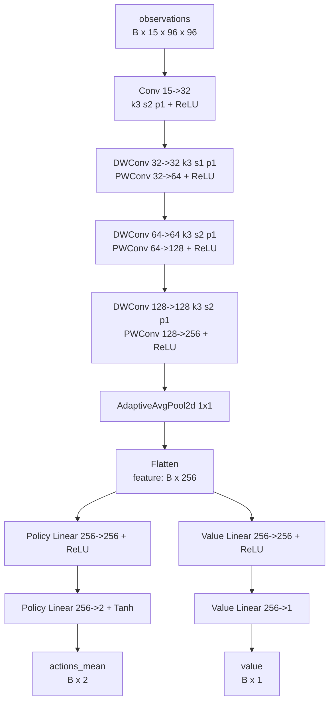

# Example 10: Visual Navigation in Gaussian Splat Scenes — gs_navsim + NOMAD

## Goal

Train a robot to navigate toward a goal image inside a **photorealistic
Gaussian Splat scene** rendered live in a browser.

The key ideas introduced here:

- **WebSocket-coupled environment** — the Gymnasium env communicates with a
  running browser session over WebSocket instead of calling a local physics
  API.
- **Frozen pretrained encoder** — NOMAD's ViNT backbone (EfficientNet-b0) is
  loaded from a checkpoint and never updated; only small MLP heads are trained.
- **Image-goal navigation** — the agent is rewarded for making the current
  camera view look like a goal photograph; no GPS or map is used.
- **Obstacle masks** — a 2-D grid mask (drawn in the browser's mask editor)
  provides collision detection on the Python side, removing the need for
  physics collision callbacks.

---

## Architecture Overview

```
Browser (gs_navsim)                Python (this example)
─────────────────────              ──────────────────────────────────────────
Gaussian Splat renderer            GsNavSimEnv (env.py)
  ↕  WebSocket :8081                 │
robot_command ──────────────────►  step()
                                     │  action [dx, dy]
                                     │  → PD controller → [v, w]
rendered_image ◄────────────────   wait for image
collision      ◄────────────────   check collision flag
                                   │
                                   ▼
                              observation (15, 96, 96)
                              = 4 × RGB frames (CHW, ImageNet-norm)
                              + 1 × goal  frame (CHW, ImageNet-norm)
                                   │
                              NomadPolicy / NomadValue (model.py)
                              = frozen NoMaD_ViNT encoder (256-d)
                              + trainable MLP heads
                                   │
                              skrl PPO trainer (train.py)
```

---

## Files

| File | What it contains |
|---|---|
| `env.py` | `GsNavSimEnv` — Gymnasium env, WebSocket client, obstacle mask, reward |
| `model.py` | `NomadPolicy` and `NomadValue` — frozen NOMAD encoder + MLP heads |
| `train.py` | PPO training entry point |
| `run.py` | Load a checkpoint and run deterministic evaluation episodes |

---

## Prerequisites

### 1 — NOMAD weights

Download the pretrained NOMAD checkpoint and place it at:

```
robot_nav/visualnav-transformer/model_weights/nomad.pth
```

The ViNT/NOMAD weights are available from the
[visualnav-transformer releases](https://github.com/robodhruv/visualnav-transformer).

### 2 — gs_navsim running

Start the WebSocket + HTTP server:

```bash
cd gs_navsim/backend
node server.js          # WebSocket on :8081, static files on :3000
```

Open the frontend in a browser:

```
http://localhost:3000
```

Load a `.ply` scene file using the file picker in the sidebar, then make sure
the scene renders correctly before starting training.

### 3 — Python dependencies

```bash
pip install -r requirements.txt
pip install websocket-client   # WebSocket client for env.py
```

### 4 — Goal image

Capture or screenshot the target view from the browser and save it as a PNG:

```bash
# The browser's "📷 Export" button saves the current rendered frame.
# Move / rename it:
cp ~/Downloads/export.png goal.png
```

### 5 — Obstacle mask (optional but recommended)

Open the mask editor in the browser (🗺 **Mask** button), paint blocked cells
over walls and furniture, then click **💾 Guardar** to download `mask.json`.

---

## Training

```bash
python -m examples.10_gs_navsim_nomad.train \
    --goal path/to/goal.png \
  --scene-id your_scene_id \
    --timesteps 200000
```

Key options:

| Flag | Default | Description |
|---|---|---|
| `--goal` | *(required)* | Path to goal image (PNG/JPG) |
| `--arch` | `nomad` | Model architecture: `nomad` or `cv181x` |
| `--scene-id` | `None` | Scene folder id from gs_navsim backend data dir (auto-load scene) |
| `--timesteps` | `200000` | Total environment steps to train |
| `--max-steps` | `500` | Max steps per episode before truncation |
| `--ws-url` | `ws://localhost:8081` | WebSocket URL of the gs_navsim server |
| `--seed` | `42` | RNG seed |
| `--checkpoint` | `None` | Resume from a saved checkpoint (`.pt`) |
| `--experiment-name` | `10_gs_navsim_nomad` | TensorBoard run label |

Checkpoints are saved to:

- `runs/10_gs_navsim_nomad/...` when `--arch nomad`
- `runs/10_gs_navsim_nomad/cv181x/...` when `--arch cv181x`

Monitor progress:

```bash
tensorboard --logdir runs/
# open http://localhost:6006
```

---

## Evaluation

```bash
python -m examples.10_gs_navsim_nomad.run \
    --checkpoint runs/10_gs_navsim_nomad/checkpoints/agent_200000.pt \
    --goal path/to/goal.png \
  --arch nomad \
  --scene-id your_scene_id \
    --episodes 10
```

The script prints per-episode statistics:

```
Episode   1  |  steps= 147  reward=  +42.31  pixel_dist=0.0181  [SUCCESS]
Episode   2  |  steps= 500  reward=  -12.05  pixel_dist=0.0834  [TIMEOUT]
Episode   3  |  steps=  23  reward=  -25.00  pixel_dist=0.1203  [COLLISION]
```

---

## CV181x-Friendly Policy (No attention / no GroupNorm)

### Model used for CV181x

The `cv181x` architecture used in this example is implemented in
`examples/10_gs_navsim_nomad/model_cv181x.py` as `Cv181xPolicy` and
`Cv181xValue`.

It is a pure CNN (no Transformer blocks) designed to avoid operations that are
problematic for CV18xx lowering.

Input/output contract:

- Input: `(B, 15, 96, 96)` float32 (`4x RGB obs + 1x RGB goal`, CHW)
- Policy output: `(B, 2)` action mean in `[-1, 1]` (final `Tanh`)
- Value output: `(B, 1)` scalar value

Backbone topology (shared by policy and value):

1. `Conv2d(15->32, k=3, s=2, p=1) + ReLU`
2. Depthwise-separable block: `DWConv(32->32, k=3, s=1, p=1) + PWConv(32->64) + ReLU`
3. Depthwise-separable block: `DWConv(64->64, k=3, s=2, p=1) + PWConv(64->128) + ReLU`
4. Depthwise-separable block: `DWConv(128->128, k=3, s=2, p=1) + PWConv(128->256) + ReLU`
5. `AdaptiveAvgPool2d(1,1)` + flatten -> 256-d feature



Heads:

- Policy head: `Linear(256->256) + ReLU + Linear(256->2) + Tanh`
- Value head: `Linear(256->256) + ReLU + Linear(256->1)`

Training vs deployment:

- During PPO training, the policy is Gaussian (`log_std_parameter` is learned).
- For export/deployment, deterministic actions (mean only) are used via the
  wrapper in `examples/10_gs_navsim_nomad/export_onnx.py`.

Why this model is suitable for CV181x:

- Uses only Conv/DepthwiseConv/ReLU/GAP/Linear/Tanh-style ops.
- Avoids `GroupNorm`, `LayerNorm`, attention, and dynamic-shape-heavy logic.
- Preserves the same observation format as the NOMAD path, so env/preprocessing
  code does not need to change.

To train the TPU-MLIR-friendly architecture:

```bash
python -m examples.10_gs_navsim_nomad.train \
  --goal path/to/goal.png \
  --arch cv181x \
  --timesteps 200000
```

Export deterministic ONNX (fixed shape) for TPU-MLIR:

```bash
python -m examples.10_gs_navsim_nomad.export_onnx \
  --checkpoint runs/10_gs_navsim_nomad/cv181x/10_gs_navsim_nomad/checkpoints/agent_200000.pt \
  --goal path/to/goal.png \
  --arch cv181x \
  --opset 17 \
  --output policy_cv181x.onnx
```

The exporter uses stable I/O names and fixed shape:

- Input: `observations` `[1, 15, 96, 96]`
- Output: `actions` `[1, 2]`

---

## Observation Space

```
Shape: (15, 96, 96)  float32
```

| Channels | Content |
|---|---|
| 0 – 11 | 4 × RGB frames (most recent last), ImageNet-normalised, CHW format |
| 12 – 14 | Goal RGB frame, same normalisation |

The NOMAD encoder expects exactly this layout (context_size = 3 past frames + 1 current).

---

## Action Space

```
Shape: (2,)  float32  ∈ [−1, 1]
```

The policy outputs a 2-D waypoint `[dx, dy]` in the robot's local frame.
A PD controller in `env.py` converts it to linear velocity `v` and angular
velocity `w` before sending the `set_velocity` command to the simulator.

---

## Reward Function

| Event | Reward |
|---|---|
| Collision with obstacle | −5.0 (episode ends) |
| Progress toward goal | `(prev_pixel_dist − curr_pixel_dist) × 100` |
| Time penalty (every step) | −0.01 |
| Goal reached (`pixel_dist < 0.02`) | +10.0 (episode ends) |

Pixel distance is the mean squared difference between the current frame and
the goal frame in ImageNet-normalised CHW space.

---

## Model Details

Both `NomadPolicy` and `NomadValue` share the same frozen encoder:

```
NoMaD_ViNT (EfficientNet-b0 backbone)
  context_size        = 3
  obs_encoding_size   = 256
  mha_num_attention_heads  = 4
  mha_num_attention_layers = 4
  mha_ff_dim_factor        = 4
```

Only the MLP heads (256 → 256 → output) are updated during PPO.
Observations are already ImageNet-normalised, so no `RunningStandardScaler`
is used.

---

## Tips

- **Scene matters** — the pixel-distance reward works best when the goal image
  is distinctive (avoid featureless white walls as goals).
- **Mask quality** — a well-drawn obstacle mask prevents the robot from getting
  stuck in walls during exploration, which dramatically speeds up early
  training.
- **Spawn randomisation** — each episode starts at a random free cell sampled
  from the mask, giving the agent diverse starting positions.
- **Single-env training** — this example uses one environment instance because
  the browser can only render one scene at a time. Expect slower wall-clock
  throughput than vectorised setups.
- **WebSocket latency** — each step waits for a rendered image; keep the
  browser tab in the foreground and hardware-accelerated to minimise latency.

---

## Full Remote on vast.ai (recommended: one-command launcher)

Use the dedicated launcher script that provisions/reuses an instance and runs
everything end-to-end:

- gs_navsim backend
- headless browser renderer (Chrome + Xvfb)
- PPO training (`nomad` or `cv181x`)

Script:

```bash
bash scripts/vast_lanunch_gs_navsim.sh --help
```

### 1 - Local prerequisites

From `reinforced/` on your local machine:

1. Create `reinforced/.env` with your vast.ai API key.
2. Ensure `vastai` CLI is available in your shell (`pip install vastai`).
3. Ensure the local scene exists at `/mnt/c/data/<scene_id>/` (or set `--scene-src`).
4. Ensure a goal image exists in the repo root if using the default examples below:
   `/workspace/robot_nav/goal.png` (remote path after sync).

Minimal `.env`:

```bash
echo 'VAST_AI_API_KEY=your_key_here' > reinforced/.env
```

### 2 - Launch command (cv181x on RTX 5090, min cost 0.8)

```bash
cd reinforced
bash scripts/vast_lanunch_gs_navsim.sh \
  --scene-id 0001_839920 \
  --goal /workspace/robot_nav/goal.png \
  --arch cv181x \
  --gpu RTX_5090 \
  --min-dph 0.8 \
  --max-dph 2.0
```

Notes:

- `--arch` supports `nomad` and `cv181x`.
- If you set `--min-dph 0.8`, also raise `--max-dph` above `0.8` (default max is `0.8`).
- The script syncs the full `robot_nav/` tree needed by this example.

### 3 - Monitor logs

The launcher prints the SSH endpoint and useful commands. Typical checks:

```bash
ssh -p <port> root@<host> 'tail -f /workspace/train.log'
ssh -p <port> root@<host> 'tail -f /workspace/gs_backend.log'
ssh -p <port> root@<host> 'tmux ls'
```

### 4 - TensorBoard tunnel

```bash
ssh -o StrictHostKeyChecking=no -p <port> -L 6006:127.0.0.1:6006 -N root@<host>
# open http://localhost:6006
```

### 5 - Sync outputs and destroy instance

```bash
cd reinforced
bash scripts/vast_sync.sh
bash scripts/vast_destroy.sh
```
